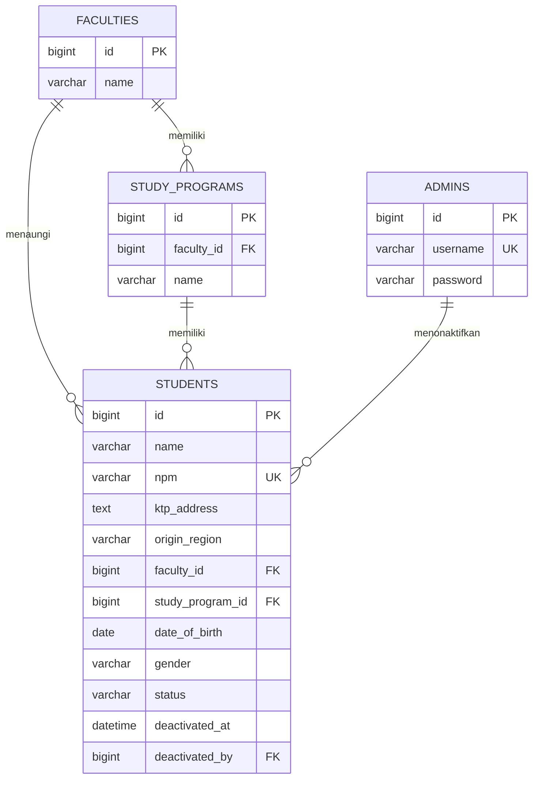
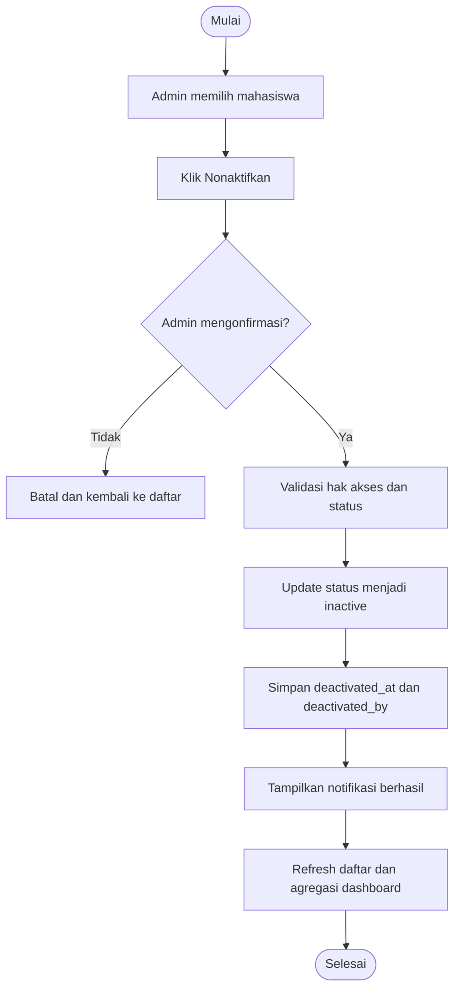

# PRODUCT REQUIREMENTS DOCUMENT (PRD)

## Sistem Manajemen Data Mahasiswa dan Dashboard Statistik

| Informasi | Detail |
|---|---|
| Nama proyek | Sistem Manajemen Data Mahasiswa dan Dashboard Statistik |
| Jenis aplikasi | Web application |
| Domain | Administrasi akademik / manajemen data mahasiswa |
| Pengguna | Guest (tamu) dan Admin |
| Pendekatan pengembangan | Analisis terstruktur dan Object-Oriented Programming (OOP) |
| Status dokumen | Baseline requirement untuk AI coding agents |
| Versi | 1.2 |
| Tanggal | 5 November 2026 |

---

## 1. Ringkasan Produk

Sistem Manajemen Data Mahasiswa adalah aplikasi web sederhana untuk mengelola data mahasiswa pada sebuah perguruan tinggi fiktif bernama **Universitas Cakrawala Nusantara (UCN)**. Sistem menyediakan dua jenis akses:

1. **Guest/Tamu** dapat membuka dashboard publik yang berisi statistik agregat mahasiswa aktif tanpa dapat melihat atau mengubah data pribadi mahasiswa.
2. **Admin** dapat login untuk melihat dashboard dan melakukan pengelolaan data mahasiswa melalui operasi tambah, lihat, ubah, dan nonaktifkan data.

Dashboard menampilkan empat visualisasi: perbandingan gender, asal daerah, fakultas/program studi, dan distribusi usia. Seluruh visualisasi hanya menghitung mahasiswa dengan status **aktif**.

Sistem menggunakan pendekatan analisis terstruktur untuk memetakan proses dan aliran data, serta OOP untuk memodelkan entitas dan tanggung jawab aplikasi. Operasi yang disebut *delete* tidak menghapus baris dari database; sistem mengubah status mahasiswa menjadi **nonaktif** sehingga riwayat data tetap tersimpan.

## 2. Latar Belakang dan Permasalahan

Pengelolaan data mahasiswa yang dilakukan secara manual atau tersebar dapat menyulitkan admin ketika memperbarui informasi, memeriksa data, dan menyusun ringkasan statistik. Pimpinan atau pengunjung juga membutuhkan gambaran demografi mahasiswa tanpa harus mengakses data pribadi satu per satu.

Sistem ini dibangun untuk menyediakan satu sumber data mahasiswa yang terpusat, alur CRUD yang terkontrol, serta dashboard statistik yang konsisten dan hanya menggunakan data mahasiswa aktif.

## 3. Tujuan Produk

### 3.1 Tujuan utama

- Menyediakan penyimpanan data mahasiswa dalam satu database terstruktur.
- Memungkinkan admin melakukan create, read, update, dan deactivate terhadap data mahasiswa.
- Menyediakan dashboard statistik yang bisa diakses guest dan admin.
- Menampilkan statistik gender, asal daerah, fakultas/program studi, dan distribusi usia.
- Memastikan data nonaktif tetap tersimpan dan tidak masuk ke perhitungan dashboard.
- Menerapkan pemisahan hak akses guest dan admin.
- Menjadi implementasi pembelajaran analisis terstruktur dan OOP.

### 3.2 Indikator keberhasilan

- Guest dapat membuka dashboard tanpa login dan tidak dapat mengakses fungsi pengelolaan data.
- Admin dapat login dan mengelola data mahasiswa.
- NPM tidak dapat didaftarkan dua kali.
- Aksi nonaktif tidak menghapus data mahasiswa secara permanen.
- Keempat grafik menghitung mahasiswa aktif saja.
- Perubahan data aktif/nonaktif tercermin pada dashboard setelah data dimuat ulang.
- Informasi pribadi seperti alamat KTP tidak ditampilkan pada dashboard guest.

## 4. Ruang Lingkup

### 4.1 Termasuk dalam MVP

- Login admin.
- Dashboard yang dapat diakses guest dan admin.
- Empat grafik statistik.
- Daftar data mahasiswa untuk admin.
- Tambah data mahasiswa.
- Detail/lihat data mahasiswa.
- Edit data mahasiswa.
- Nonaktifkan data mahasiswa tanpa menghapusnya dari database.
- Aktifkan kembali mahasiswa nonaktif.
- Pencarian dan filter sederhana pada daftar mahasiswa.
- Validasi input dan proteksi akses berdasarkan role.
- Seed data contoh fiktif untuk demonstrasi.

### 4.2 Tidak termasuk dalam MVP

- Registrasi akun mahasiswa atau portal mahasiswa.
- SSO dengan sistem akademik kampus.
- Integrasi PDDikti atau API pihak ketiga.
- Import massal Excel/CSV dan export laporan.
- Manajemen banyak role selain guest dan admin.
- Pengelolaan nilai, KRS, pembayaran, presensi, atau jadwal kuliah.
- Notifikasi email/WhatsApp.
- Audit trail tingkat enterprise atau workflow persetujuan.
- Multi-tenant untuk banyak universitas.

## 5. Asumsi dan Keputusan Requirement

1. Nama kampus **Universitas Cakrawala Nusantara (UCN)** hanya nama fiktif untuk demonstrasi dan dapat diganti.
2. Aplikasi berbasis web dan responsif untuk desktop, tablet, serta ponsel.
3. Guest tidak perlu membuat akun dan hanya dapat melihat statistik agregat.
4. Admin adalah satu role operasional. Akun admin dapat disediakan secara statis melalui konfigurasi/seeder untuk kebutuhan demonstrasi.
5. Terdapat enam kolom utama pada tabel daftar mahasiswa sesuai permintaan:
   - Nama
   - NPM
   - Alamat sesuai KTP
   - Asal daerah
   - Fakultas / Program Studi
   - Tanggal lahir
6. **Jenis kelamin adalah field pendukung wajib** pada formulir dan database, tetapi tidak dimasukkan ke dalam enam kolom utama daftar. Field ini diperlukan untuk menghitung grafik laki-laki dan perempuan.
7. Fakultas dan program studi disimpan sebagai entitas terpisah agar relasinya konsisten. Pada tabel mahasiswa keduanya ditampilkan dalam satu kolom gabungan “Fakultas / Program Studi”.
8. “Asal daerah” direpresentasikan sebagai nama kabupaten/kota dan provinsi atau label daerah yang distandardisasi. Format final dapat disesuaikan dengan kebutuhan kampus.
9. Usia tidak disimpan sebagai angka tetap. Usia dihitung dari tanggal lahir terhadap tanggal saat dashboard diakses.
10. Status mahasiswa hanya memiliki nilai `active` dan `inactive` pada MVP.
11. Zona waktu aplikasi menggunakan `Asia/Jakarta`.
12. Jika repository sudah memiliki stack atau konvensi, AI agent harus mengikuti kondisi repository tersebut. Jangan mengganti stack tanpa alasan teknis dan persetujuan eksplisit.

## 6. Pengguna dan Hak Akses

| Fitur | Guest/Tamu | Admin |
|---|:---:|:---:|
| Membuka dashboard | Ya | Ya |
| Melihat empat grafik | Ya | Ya |
| Melihat angka ringkasan mahasiswa aktif | Ya | Ya |
| Login | Tidak | Ya |
| Membuka daftar mahasiswa | Tidak | Ya |
| Melihat detail data personal mahasiswa | Tidak | Ya |
| Menambah data mahasiswa | Tidak | Ya |
| Mengubah data mahasiswa | Tidak | Ya |
| Menonaktifkan mahasiswa | Tidak | Ya |
| Mengaktifkan kembali mahasiswa | Tidak | Ya |
| Mengelola data fakultas/program studi | Tidak | Di luar MVP, kecuali diperlukan sebagai data master awal |

### 6.1 Guest

Guest adalah pengunjung tanpa autentikasi. Guest hanya dapat mengakses halaman dashboard dan data statistik agregat. Guest tidak boleh menerima data mentah mahasiswa dari endpoint API, termasuk alamat KTP, NPM, nama, atau tanggal lahir individual.

### 6.2 Admin

Admin adalah pengguna terautentikasi yang dapat mengakses dashboard dan modul pengelolaan mahasiswa. Admin dapat menambah, melihat, memperbarui, menonaktifkan, dan mengaktifkan kembali data mahasiswa.

### 6.3 Ketentuan login admin statis

Untuk demo/tugas, akun admin boleh disiapkan melalui seeder atau konfigurasi environment. Kredensial tidak boleh ditulis langsung di source code yang di-commit. Password harus disimpan dalam bentuk hash jika menggunakan tabel admin. Tidak ada registrasi publik dan tidak ada halaman login untuk guest.

## 7. Alur Penggunaan Utama

### 7.1 Alur Guest

1. Guest membuka URL aplikasi.
2. Sistem menampilkan dashboard.
3. Sistem mengambil agregat mahasiswa berstatus aktif.
4. Sistem menampilkan ringkasan dan empat grafik.
5. Guest tidak melihat tombol atau menu CRUD.

### 7.2 Alur Admin

1. Admin membuka halaman login.
2. Admin memasukkan kredensial.
3. Sistem memvalidasi kredensial dan membuat sesi autentikasi.
4. Admin diarahkan ke dashboard atau halaman daftar mahasiswa.
5. Admin memilih tambah, detail, edit, atau nonaktifkan data.
6. Sistem memvalidasi perubahan dan menyimpan ke database.
7. Dashboard menggunakan data terbaru pada pemuatan/refresh berikutnya.

### 7.3 Alur Nonaktifkan Data

1. Admin memilih aksi “Nonaktifkan” pada mahasiswa.
2. Sistem menampilkan konfirmasi yang menyebutkan bahwa data tidak akan dihapus permanen.
3. Jika admin mengonfirmasi, sistem mengubah `status` menjadi `inactive`.
4. Sistem mengisi `deactivated_at` dan `deactivated_by` bila tersedia.
5. Data tetap tersimpan dan dapat dilihat melalui filter data nonaktif.
6. Data tersebut tidak lagi masuk ke angka ringkasan dan seluruh grafik.

### 7.4 Alur Aktifkan Kembali

1. Admin memilih filter “Nonaktif”.
2. Admin memilih mahasiswa dan aksi “Aktifkan kembali”.
3. Sistem mengubah status menjadi `active` dan mengosongkan metadata deaktivasi yang relevan.
4. Data kembali dihitung dalam dashboard.

## 8. Kebutuhan Fungsional

Prioritas: **Must** = wajib untuk MVP; **Should** = disarankan; **Could** = opsional.

### 8.1 Autentikasi dan Otorisasi

| ID | Kebutuhan | Prioritas |
|---|---|---|
| FR-AUTH-01 | Sistem menyediakan halaman login khusus admin. | Must |
| FR-AUTH-02 | Sistem memvalidasi kredensial admin. | Must |
| FR-AUTH-03 | Sistem menyediakan logout dan mengakhiri sesi admin. | Must |
| FR-AUTH-04 | Guest dapat membuka dashboard tanpa login. | Must |
| FR-AUTH-05 | Hanya admin terautentikasi yang dapat mengakses endpoint dan halaman CRUD. | Must |
| FR-AUTH-06 | Guest yang mencoba mengakses endpoint CRUD harus ditolak (HTTP 401/403 atau redirect login sesuai arsitektur). | Must |
| FR-AUTH-07 | Sistem tidak menyediakan registrasi akun publik. | Must |

### 8.2 Dashboard dan Statistik

| ID | Kebutuhan | Prioritas |
|---|---|---|
| FR-DASH-01 | Dashboard menampilkan jumlah seluruh mahasiswa aktif. | Must |
| FR-DASH-02 | Dashboard menampilkan grafik perbandingan mahasiswa laki-laki dan perempuan. | Must |
| FR-DASH-03 | Dashboard menampilkan grafik jumlah mahasiswa berdasarkan asal daerah. | Must |
| FR-DASH-04 | Dashboard menampilkan grafik mahasiswa berdasarkan fakultas dan program studi. | Must |
| FR-DASH-05 | Dashboard menampilkan grafik distribusi/sebaran usia mahasiswa. | Must |
| FR-DASH-06 | Semua agregasi dashboard hanya menghitung mahasiswa berstatus `active`. | Must |
| FR-DASH-07 | Dashboard tidak menampilkan data personal mahasiswa. | Must |
| FR-DASH-08 | Grafik memiliki judul, label kategori, nilai/jumlah, dan empty state. | Must |
| FR-DASH-09 | Dashboard menampilkan keterangan waktu pembaruan data atau menyediakan refresh yang jelas. | Should |
| FR-DASH-10 | Admin dapat berpindah dari dashboard ke modul pengelolaan data. | Must |

**Keputusan jumlah grafik:** requirement menyebut “3 grafik wajib”, tetapi daftar analisis berisi empat topik. MVP menetapkan **empat grafik** agar seluruh topik dipenuhi. Ini melampaui minimum tiga grafik dan tidak menghilangkan kebutuhan distribusi usia.

### 8.3 Manajemen Data Mahasiswa

| ID | Kebutuhan | Prioritas |
|---|---|---|
| FR-STU-01 | Admin dapat melihat daftar mahasiswa. | Must |
| FR-STU-02 | Daftar mahasiswa menampilkan tepat enam kolom utama yang diminta. | Must |
| FR-STU-03 | Admin dapat menambah data mahasiswa. | Must |
| FR-STU-04 | Admin dapat melihat detail satu mahasiswa. | Must |
| FR-STU-05 | Admin dapat mengubah data mahasiswa. | Must |
| FR-STU-06 | Admin dapat menonaktifkan data mahasiswa tanpa menghapus row dari database. | Must |
| FR-STU-07 | Admin dapat melihat data aktif dan nonaktif melalui filter status. | Must |
| FR-STU-08 | Admin dapat mengaktifkan kembali data mahasiswa nonaktif. | Must |
| FR-STU-09 | Sistem menolak NPM duplikat. | Must |
| FR-STU-10 | Admin dapat mencari mahasiswa berdasarkan nama atau NPM. | Should |
| FR-STU-11 | Admin dapat memfilter daftar berdasarkan status, fakultas, program studi, dan asal daerah. | Should |
| FR-STU-12 | Daftar mahasiswa menggunakan pagination jika jumlah data melebihi batas tampilan. | Should |

**Enam kolom utama daftar:**

| No. | Kolom | Sumber data |
|---:|---|---|
| 1 | Nama | `students.name` |
| 2 | NPM | `students.npm` |
| 3 | Alamat sesuai KTP | `students.ktp_address` |
| 4 | Asal daerah | `students.origin_region` |
| 5 | Fakultas / Program Studi | Relasi `faculty` dan `study_program` |
| 6 | Tanggal lahir | `students.date_of_birth` |

Field `gender` tetap wajib tersedia dalam form/detail dan database, tetapi bukan bagian dari enam kolom utama tabel. Status dapat ditampilkan sebagai badge/indikator di luar enam kolom utama atau melalui filter status.

### 8.4 Kebutuhan Formulir Mahasiswa

Form tambah dan edit minimal memuat:

| Field | Tipe | Wajib | Aturan |
|---|---|:---:|---|
| Nama | Teks | Ya | 2–150 karakter; trim whitespace |
| NPM | Teks | Ya | 5–30 karakter; unik; simpan sebagai string agar format/angka nol di depan tidak hilang |
| Alamat sesuai KTP | Teks panjang | Ya | 5–500 karakter; hanya admin yang dapat melihat |
| Asal daerah | Pilihan/teks terstandar | Ya | Nama kabupaten/kota dan provinsi atau label daerah terstandar |
| Fakultas | Pilihan | Ya | Harus berasal dari master fakultas |
| Program studi | Pilihan | Ya | Harus berada di bawah fakultas yang dipilih |
| Tanggal lahir | Date | Ya | Tanggal valid dan tidak boleh di masa depan |
| Jenis kelamin | Pilihan | Ya | `male` atau `female` untuk memenuhi kebutuhan grafik |

Catatan: format NPM dan panjang field dapat disesuaikan dengan aturan kampus. Jangan mengasumsikan NPM harus numerik murni sebelum ada ketentuan resmi.

## 9. Definisi Dashboard dan Perhitungan Grafik

### 9.1 Aturan umum perhitungan

- Sumber data adalah tabel mahasiswa (`students`).
- Filter wajib: `status = 'active'`.
- Data nonaktif tidak boleh ikut dalam total, persentase, label kategori, atau agregasi grafik.
- Statistik dihitung dari data terkini di database, bukan angka hard-coded.
- Hindari mengirim data mahasiswa individual ke frontend untuk kemudian dihitung di browser. Backend sebaiknya mengirim hasil agregasi.
- Bila tidak ada data aktif, tampilkan nilai ringkasan `0` dan empty state pada tiap grafik, bukan error.
- Persentase dihitung dari jumlah kategori dibagi total mahasiswa aktif dan dikalikan 100. Tangani pembagian dengan nol.

### 9.2 Grafik 1 — Perbandingan Mahasiswa Laki-laki dan Perempuan

- Tujuan: menunjukkan komposisi gender mahasiswa aktif.
- Tipe visualisasi yang disarankan: doughnut/pie chart.
- Dimensi: `gender`.
- Metrik: `COUNT(student_id)`.
- Kategori: Laki-laki (`male`) dan Perempuan (`female`).
- Tooltip/label menampilkan jumlah dan persentase.
- Data gender wajib diisi pada saat membuat mahasiswa agar tidak ada kategori tanpa klasifikasi.

### 9.3 Grafik 2 — Mahasiswa Berdasarkan Asal Daerah

- Tujuan: mengetahui sebaran asal daerah mahasiswa aktif.
- Tipe visualisasi yang disarankan: horizontal bar chart.
- Dimensi: `origin_region`.
- Metrik: `COUNT(student_id)`.
- Urutkan dari jumlah terbesar ke terkecil.
- Jika kategori sangat banyak, tampilkan 10 daerah teratas dan gabungkan sisanya sebagai “Daerah lainnya”. Total gabungan harus tetap sama dengan total data aktif.
- Penamaan daerah perlu distandardisasi agar variasi penulisan yang sama tidak menghasilkan kategori terpisah.

### 9.4 Grafik 3 — Mahasiswa Berdasarkan Fakultas dan Program Studi

- Tujuan: menampilkan jumlah mahasiswa aktif per program studi dan mengelompokkannya berdasarkan fakultas.
- Tipe visualisasi yang disarankan: bar chart berkelompok/stacked bar atau bar chart program studi dengan label fakultas.
- Dimensi: fakultas dan program studi.
- Metrik: `COUNT(student_id)`.
- Program studi harus terhubung ke fakultas induk.
- UI boleh menyediakan filter fakultas atau drill-down agar label tetap terbaca.
- Jangan menjumlahkan satu mahasiswa lebih dari satu kali dalam satu agregasi.

### 9.5 Grafik 4 — Distribusi Usia Mahasiswa

- Tujuan: menunjukkan sebaran usia mahasiswa aktif.
- Tipe visualisasi yang disarankan: histogram atau bar chart kelompok usia.
- Usia dihitung dari `date_of_birth` terhadap tanggal hari ini pada zona waktu `Asia/Jakarta`.
- Usia tidak disimpan permanen di database.
- Kelompok usia default:
  - 17–20 tahun
  - 21–23 tahun
  - 24–26 tahun
  - 27 tahun ke atas
- Kelompok dapat disesuaikan apabila data mahasiswa memperlihatkan rentang yang berbeda. Jangan mengubah kategori tanpa memperbarui dokumentasi dan pengujian.
- Tanggal lahir kosong/tidak valid tidak boleh dipaksakan menjadi usia 0; validasi data harus mencegahnya.

### 9.6 Kartu Ringkasan Dashboard

MVP minimal menampilkan:

- Total mahasiswa aktif.
- Total mahasiswa laki-laki.
- Total mahasiswa perempuan.
- Total fakultas yang memiliki mahasiswa aktif (opsional jika master data tersedia).
- Terakhir diperbarui.

Kartu tambahan tidak boleh menggantikan empat grafik wajib.

## 10. Model Data dan Database

### 10.1 Entitas utama

1. `students`
2. `faculties`
3. `study_programs`
4. `admins` (atau mekanisme autentikasi setara dari framework)

### 10.2 Struktur tabel yang disarankan

#### Tabel `students`

| Kolom | Tipe konseptual | Ketentuan |
|---|---|---|
| `id` | BIGINT / UUID | Primary key |
| `name` | VARCHAR(150) | Not null |
| `npm` | VARCHAR(30) | Not null, unique |
| `ktp_address` | TEXT | Not null; data pribadi |
| `origin_region` | VARCHAR(150) | Not null; format terstandar |
| `faculty_id` | Foreign key | Not null, references `faculties.id` |
| `study_program_id` | Foreign key | Not null, references `study_programs.id` |
| `date_of_birth` | DATE | Not null, tidak boleh masa depan |
| `gender` | ENUM / VARCHAR(10) | Not null; `male` atau `female` |
| `status` | ENUM / VARCHAR(10) | Not null; `active` atau `inactive`; default `active` |
| `deactivated_at` | DATETIME nullable | Waktu penonaktifan |
| `deactivated_by` | Foreign key nullable | Admin yang menonaktifkan |
| `created_at` | DATETIME | Timestamp pembuatan |
| `updated_at` | DATETIME | Timestamp perubahan |

Catatan: `deactivated_by` boleh nullable jika implementasi autentikasi demo tidak menyediakan relasi admin. Jangan menghilangkan informasi status.

#### Tabel `faculties`

| Kolom | Tipe konseptual | Ketentuan |
|---|---|---|
| `id` | BIGINT / UUID | Primary key |
| `name` | VARCHAR(150) | Not null, unique |
| `created_at`, `updated_at` | DATETIME | Timestamp |

#### Tabel `study_programs`

| Kolom | Tipe konseptual | Ketentuan |
|---|---|---|
| `id` | BIGINT / UUID | Primary key |
| `faculty_id` | Foreign key | Not null, references `faculties.id` |
| `name` | VARCHAR(150) | Not null |
| `created_at`, `updated_at` | DATETIME | Timestamp |

Constraint yang disarankan: kombinasi (`faculty_id`, `name`) unik. Program studi yang dipilih pada mahasiswa harus benar-benar milik fakultas yang dipilih.

#### Tabel `admins`

Jika memakai tabel admin sendiri:

| Kolom | Tipe konseptual | Ketentuan |
|---|---|---|
| `id` | BIGINT / UUID | Primary key |
| `username` atau `email` | VARCHAR(150) | Unique |
| `password` | VARCHAR | Password hash, bukan plaintext |
| `created_at`, `updated_at` | DATETIME | Timestamp |

### 10.3 Relasi ERD



### 10.4 Indeks dan integritas data

- Unique index pada `students.npm`.
- Index pada `students.status`.
- Index pada `students.gender`, `students.origin_region`, `students.faculty_id`, `students.study_program_id`, dan `students.date_of_birth` jika query agregasi menunjukkan kebutuhan.
- Foreign key untuk relasi fakultas, program studi, dan admin.
- Gunakan transaksi database saat menyimpan operasi yang mengubah beberapa tabel.
- Jangan melakukan hard delete terhadap mahasiswa melalui antarmuka aplikasi.

## 11. Aturan Bisnis

| ID | Aturan |
|---|---|
| BR-01 | NPM harus unik untuk seluruh data mahasiswa, baik aktif maupun nonaktif. |
| BR-02 | Mahasiswa baru memiliki status `active` secara default. |
| BR-03 | Aksi delete pada UI berarti menonaktifkan data, bukan menghapus row. |
| BR-04 | Data nonaktif tetap dapat dilihat admin melalui filter status. |
| BR-05 | Hanya mahasiswa aktif yang dihitung pada seluruh grafik dan kartu statistik. |
| BR-06 | Mahasiswa nonaktif tidak ditampilkan dalam daftar default jika default filter adalah aktif. |
| BR-07 | Mahasiswa nonaktif dapat diaktifkan kembali oleh admin. |
| BR-08 | NPM milik mahasiswa nonaktif tidak dapat digunakan untuk membuat mahasiswa baru. Admin harus mengaktifkan kembali atau memperbarui data yang sudah ada. |
| BR-09 | Program studi harus berasal dari fakultas yang dipilih. |
| BR-10 | Tanggal lahir tidak boleh melewati tanggal hari ini. |
| BR-11 | Usia dihitung secara dinamis dari tanggal lahir, bukan dari field usia tersimpan. |
| BR-12 | Guest hanya menerima data agregat, bukan data personal mahasiswa. |
| BR-13 | Setiap operasi CRUD hanya dapat dilakukan oleh admin terautentikasi. |
| BR-14 | Perubahan status aktif/nonaktif harus langsung memengaruhi hasil agregasi pada request dashboard selanjutnya. |

## 12. Pendekatan Analisis Terstruktur

AI agent perlu mendokumentasikan sistem menggunakan artefak analisis terstruktur berikut. Artefak dapat disimpan di folder `docs/`.

### 12.1 Diagram konteks (Context Diagram)

Entitas eksternal:

- **Guest:** meminta dan menerima ringkasan statistik mahasiswa aktif.
- **Admin:** melakukan login, meminta daftar/detail mahasiswa, dan mengirim data untuk create/update/deactivate/reactivate.

Sistem berinteraksi dengan database untuk mengambil data mahasiswa, menyimpan perubahan, serta menghasilkan agregasi dashboard.

### 12.2 DFD Level 0

Proses utama:

1. **P1 — Autentikasi Admin:** memvalidasi kredensial admin dan mengelola sesi.
2. **P2 — Pengelolaan Data Mahasiswa:** memproses tambah, lihat, ubah, nonaktifkan, dan aktifkan kembali mahasiswa.
3. **P3 — Penyajian Dashboard:** mengambil mahasiswa aktif dan menghasilkan ringkasan statistik.

Data store:

- **D1:** Data Admin.
- **D2:** Data Mahasiswa.
- **D3:** Data Fakultas dan Program Studi.

### 12.3 DFD Level 1 — Pengelolaan Mahasiswa

- Admin mengirim input mahasiswa ke P2.
- P2 melakukan validasi format dan keunikan NPM.
- Jika valid, P2 menyimpan atau memperbarui D2.
- Untuk aksi nonaktif, P2 mengubah status dan metadata deaktivasi pada D2.
- Untuk aksi aktifkan kembali, P2 memperbarui status menjadi aktif.
- P2 mengirim hasil operasi kepada admin.

### 12.4 DFD Level 1 — Dashboard

- Guest/Admin meminta dashboard.
- P3 mengambil data dari D2 dengan filter `status = active`.
- P3 mengelompokkan data berdasarkan gender, asal daerah, fakultas/program studi, dan kelompok usia.
- P3 mengirim data agregat ke antarmuka dashboard.
- P3 tidak mengirim nama, NPM, alamat KTP, atau tanggal lahir individual.

### 12.5 Use Case

**Guest:**

- UC-01: Melihat dashboard statistik mahasiswa aktif.

**Admin:**

- UC-02: Login.
- UC-03: Melihat dashboard.
- UC-04: Melihat daftar mahasiswa.
- UC-05: Menambah mahasiswa.
- UC-06: Melihat detail mahasiswa.
- UC-07: Mengubah data mahasiswa.
- UC-08: Menonaktifkan mahasiswa.
- UC-09: Melihat data mahasiswa nonaktif.
- UC-10: Mengaktifkan kembali mahasiswa.
- UC-11: Logout.

### 12.6 Flowchart proses nonaktifkan mahasiswa



## 13. Pendekatan Object-Oriented Programming (OOP)

Gunakan OOP untuk memisahkan data, aturan bisnis, dan presentasi. Nama kelas berikut adalah rekomendasi konseptual dan dapat disesuaikan dengan framework.

### 13.1 Entitas / Model

- `Student`: merepresentasikan mahasiswa dan perilaku perubahan status.
- `Faculty`: merepresentasikan fakultas.
- `StudyProgram`: merepresentasikan program studi dan relasi fakultas.
- `Admin`: merepresentasikan admin terautentikasi.

Contoh tanggung jawab `Student`:

- Menyimpan atribut mahasiswa.
- Memeriksa status aktif/nonaktif.
- Menjalankan perilaku `deactivate()` dan `reactivate()` melalui aturan domain.
- Tidak bertanggung jawab untuk menggambar grafik atau menangani HTTP.

### 13.2 Service / Use Case

- `StudentService`: menangani create, update, detail, deactivate, dan reactivate.
- `DashboardService`: menghitung agregasi statistik mahasiswa aktif.
- `AuthService` atau komponen autentikasi bawaan framework: memvalidasi login/logout.

### 13.3 Repository / Data Access

- `StudentRepository`: query daftar, pencarian, penyimpanan, perubahan status, dan agregasi data mahasiswa.
- `FacultyRepository` dan `StudyProgramRepository`: mengambil data master.

Repository pattern dapat digunakan apabila sesuai dengan skala dan framework. Jangan membuat lapisan abstraksi berlebihan untuk aplikasi kecil.

### 13.4 Controller dan View

- `AuthController`: login/logout.
- `DashboardController`: menampilkan dashboard dan menyajikan agregasi.
- `StudentController`: endpoint/aksi CRUD mahasiswa.
- View/component: hanya bertanggung jawab untuk presentasi dan interaksi UI; jangan menaruh aturan bisnis kompleks di dalam view.

### 13.5 Prinsip desain

- Encapsulation: atribut dan perubahan status dikendalikan melalui model/service yang sesuai.
- Single Responsibility: controller tidak menjadi tempat semua query dan aturan bisnis.
- Separation of Concerns: UI, business logic, dan data access dipisahkan.
- Reuse: validasi dan agregasi tidak diduplikasi pada banyak halaman.
- KISS: gunakan pola yang membantu keterbacaan; hindari factory, interface, repository, atau dependency injection yang tidak memberi manfaat nyata.

## 14. Rekomendasi Arsitektur Aplikasi

Gunakan **modular monolith** untuk MVP. Pisahkan modul secara logis tanpa microservices.

Lapisan yang disarankan:

1. Presentation: halaman, komponen UI, controller/route handler.
2. Application: service/use case untuk alur pengelolaan mahasiswa dan dashboard.
3. Domain: model dan aturan bisnis mahasiswa.
4. Infrastructure: ORM, database, autentikasi, dan implementasi repository.

### 14.1 Tech stack

Jika repository belum menentukan stack, gunakan stack berikut:

- Backend/API: PHP dengan Laravel.
- Frontend: Next.js dengan TypeScript dan App Router.
- Database: MySQL atau MariaDB.
- Styling: Tailwind CSS pada aplikasi Next.js.
- Desain frontend: skill `design-taste-frontend` dari `Leonxlnx/taste-skill` sebagai panduan design system dan verifikasi visual.
- Grafik: Chart.js atau library chart React setara pada Next.js.
- Authentication: Laravel Sanctum dengan autentikasi session-cookie untuk first-party Next.js; jangan gunakan token browser seperti `localStorage`.

Laravel menjadi pemilik API, aturan bisnis, validasi, ORM, database, dan autentikasi. Next.js menjadi pemilik halaman, komponen UI, interaksi client, serta visualisasi grafik. Keduanya berada pada aplikasi/direktori terpisah dalam satu repository atau repository terpisah sesuai kebutuhan deployment.

Konfigurasi Laravel Sanctum wajib menetapkan domain frontend sebagai stateful, mengizinkan origin Next.js secara eksplisit pada CORS, mendukung credentials, serta memakai CSRF cookie sebelum request login atau request yang mengubah data. Route API terproteksi memakai `auth:sanctum`.

Gunakan `design-taste-frontend` untuk merancang dan memverifikasi frontend Next.js. Prioritas desain proyek ini adalah dashboard administrasi berbasis data: keterbacaan tabel, filter, form, validasi, grafik, state loading/error/empty, responsivitas, dan aksesibilitas. Jangan menerapkan pola landing page, animasi berat, atau visual dekoratif yang mengurangi kegunaan aplikasi.

Skill membutuhkan Node.js 22+ serta Chrome, Edge, atau Chromium. Instalasi yang digunakan:

```bash
npx skills add https://github.com/Leonxlnx/taste-skill --skill "design-taste-frontend"
```

Ini adalah stack yang dipilih untuk proyek ini. Jangan menambah Redis, queue, microservices, atau infrastruktur lain karena tidak diperlukan oleh MVP.

### 14.2 Kontrak API dashboard yang disarankan

Laravel mengembalikan agregat sejenis berikut dari API (nama properti dan URL boleh menyesuaikan konvensi proyek):

```json
{
  "summary": {
    "total_active_students": 0,
    "male_count": 0,
    "female_count": 0,
    "generated_at": "2026-11-05T20:00:00+07:00"
  },
  "gender_distribution": [
    { "label": "Laki-laki", "count": 0, "percentage": 0 },
    { "label": "Perempuan", "count": 0, "percentage": 0 }
  ],
  "origin_distribution": [],
  "faculty_program_distribution": [],
  "age_distribution": [
    { "label": "17-20", "count": 0 },
    { "label": "21-23", "count": 0 },
    { "label": "24-26", "count": 0 },
    { "label": "27+", "count": 0 }
  ]
}
```

Contoh di atas adalah bentuk kontrak, bukan data produksi. Data yang dikirim ke guest harus agregat saja.

### 14.3 Kontrak autentikasi dan API

- Next.js meminta CSRF cookie Laravel sebelum login dan sebelum request `POST`, `PUT`, `PATCH`, atau `DELETE` yang memakai autentikasi cookie.
- Login, logout, dan endpoint informasi admin memakai Laravel Sanctum dengan session cookie dan `credentials: 'include'`.
- Semua endpoint CRUD mahasiswa dilindungi middleware `auth:sanctum`; Laravel mengembalikan `401` atau `403` untuk guest.
- Endpoint agregat dashboard publik tidak membutuhkan autentikasi dan hanya mengembalikan statistik agregat.
- Next.js tidak menyimpan token autentikasi pada `localStorage`, `sessionStorage`, atau JavaScript cookie.
- URL endpoint mengikuti konvensi proyek. Contoh: `GET /api/dashboard`, `POST /api/login`, `POST /api/logout`, dan `/api/admin/students`.

## 15. Kebutuhan Antarmuka dan UX

### 15.1 Halaman

1. `/` atau `/dashboard` — dashboard publik.
2. `/admin/login` — login admin.
3. `/admin/students` — daftar mahasiswa.
4. `/admin/students/create` — tambah mahasiswa.
5. `/admin/students/{id}` — detail mahasiswa.
6. `/admin/students/{id}/edit` — edit mahasiswa.

Rute aktual mengikuti framework; contoh di atas bersifat konseptual.

### 15.2 Dashboard

- Header menampilkan nama universitas dan judul dashboard.
- Dashboard memuat kartu ringkasan dan empat grafik.
- Layout responsif dan tidak memotong label grafik.
- Tampilkan loading state, error state, dan empty state.
- Tidak menampilkan alamat, NPM, nama, atau detail individu pada halaman publik.

### 15.3 Daftar mahasiswa admin

- Menampilkan enam kolom utama yang ditentukan.
- Menyediakan tombol tambah data.
- Menyediakan aksi detail, edit, dan nonaktifkan.
- Menyediakan filter aktif/nonaktif.
- Aksi nonaktif wajib menggunakan dialog konfirmasi.
- Gunakan badge status bila ditampilkan; status bukan pengganti salah satu dari enam kolom utama.

### 15.4 Form mahasiswa

- Label setiap field jelas.
- Field wajib diberi indikator.
- Validasi Laravel server-side selalu dilakukan meskipun validasi client-side Next.js tersedia.
- Program studi diperbarui berdasarkan fakultas yang dipilih.
- Pesan error dari API dipetakan ke field form yang harus diperbaiki.
- Setelah berhasil, tampilkan notifikasi dan arahkan admin ke detail/daftar sesuai pola UI yang konsisten.

## 16. Kebutuhan Nonfungsional

| ID | Kebutuhan | Kriteria |
|---|---|---|
| NFR-01 | Keamanan akses | Endpoint pengelolaan mahasiswa dilindungi autentikasi dan otorisasi admin. |
| NFR-02 | Privasi | Guest hanya menerima agregat; alamat KTP dan data personal tidak dikirim ke dashboard publik. |
| NFR-03 | Integritas | NPM unik dan relasi fakultas/program studi valid. |
| NFR-04 | Retensi data | Aksi nonaktif tidak menghapus record mahasiswa. |
| NFR-05 | Performa | Dashboard dan daftar mahasiswa untuk dataset tugas/demo normalnya selesai dimuat dalam 3 detik pada lingkungan lokal yang wajar. |
| NFR-06 | Responsif | Dashboard dan form dapat digunakan pada desktop dan mobile. |
| NFR-07 | Usability | Pesan sukses, error, konfirmasi, loading, dan empty state tersedia. |
| NFR-08 | Maintainability | Struktur kode memisahkan UI, business logic, dan data access secara proporsional. |
| NFR-09 | Timezone | Perhitungan usia dan timestamp mengikuti `Asia/Jakarta`. |
| NFR-10 | Reliability | Kegagalan validasi tidak boleh meninggalkan perubahan data parsial. |
| NFR-11 | Accessibility | Form memiliki label; kontras dan navigasi keyboard dasar diperhatikan. |
| NFR-12 | Logging | Error aplikasi dicatat tanpa mengekspos password atau data sensitif ke log. |

## 17. Keamanan dan Privasi

- Semua validasi penting dilakukan di backend.
- Gunakan ORM atau parameterized query; hindari SQL string concatenation dari input pengguna.
- Lindungi request mutasi dari Next.js ke Laravel dengan CSRF cookie dan header CSRF saat memakai session/cookie authentication.
- Konfigurasikan CORS Laravel hanya untuk origin Next.js yang diizinkan dan aktifkan credentials; jangan gunakan origin `*` bersama credentials.
- Terapkan output escaping untuk mencegah XSS.
- Password admin tidak boleh disimpan plaintext.
- Jangan commit file `.env`, password, token, atau kredensial demo.
- Batasi akses alamat KTP hanya pada admin.
- Endpoint publik dashboard hanya mengembalikan data agregat.
- Jangan menampilkan record dengan NPM/nama/alamat pada chart tooltip.
- Sediakan konfirmasi sebelum deaktivasi.
- Jangan membuat endpoint hard delete untuk mahasiswa pada MVP.
- Gunakan data fiktif untuk development, screenshot, dan presentasi. Jangan memasukkan data KTP/NPM nyata ke repository atau seed.

## 18. Kriteria Penerimaan (Acceptance Criteria)

### 18.1 Akses dan autentikasi

- [ ] Guest dapat membuka dashboard tanpa login.
- [ ] Guest tidak melihat menu CRUD.
- [ ] Guest tidak dapat memanggil endpoint CRUD dengan akses langsung.
- [ ] Admin dapat login menggunakan kredensial demo yang dikonfigurasi.
- [ ] Admin dapat logout.
- [ ] Setelah logout, halaman/endpoint terlindungi tidak bisa diakses tanpa login ulang.

### 18.2 CRUD

- [ ] Admin dapat menambah mahasiswa dengan semua field wajib.
- [ ] Sistem menolak NPM kosong atau duplikat.
- [ ] Sistem menolak tanggal lahir di masa depan.
- [ ] Sistem menolak program studi yang tidak terkait dengan fakultas terpilih.
- [ ] Admin dapat melihat detail dan mengubah data mahasiswa.
- [ ] Admin dapat menonaktifkan mahasiswa melalui konfirmasi.
- [ ] Setelah dinonaktifkan, record masih ada di database dengan status `inactive`.
- [ ] Admin dapat menemukan dan mengaktifkan kembali mahasiswa nonaktif.
- [ ] NPM mahasiswa nonaktif tetap dianggap sudah digunakan.

### 18.3 Dashboard

- [ ] Dashboard memiliki grafik gender.
- [ ] Dashboard memiliki grafik asal daerah.
- [ ] Dashboard memiliki grafik fakultas/program studi.
- [ ] Dashboard memiliki grafik distribusi usia.
- [ ] Seluruh grafik menggunakan data aktif saja.
- [ ] Menonaktifkan seorang mahasiswa mengurangi angka agregasi yang sesuai.
- [ ] Mengaktifkan kembali mahasiswa menambah angka agregasi yang sesuai.
- [ ] Dashboard tidak menampilkan data personal individual.
- [ ] Ketika tidak ada mahasiswa aktif, semua angka bernilai nol dan grafik menampilkan empty state.

## 19. Skenario Pengujian Minimum

| ID | Skenario | Hasil yang diharapkan |
|---|---|---|
| TC-01 | Guest membuka dashboard | Dashboard tampil tanpa login. |
| TC-02 | Guest membuka halaman daftar mahasiswa | Akses ditolak/diarahkan ke halaman yang sesuai. |
| TC-03 | Guest memanggil endpoint create | Request ditolak. |
| TC-04 | Admin login dengan kredensial valid | Sesi admin dibuat. |
| TC-05 | Admin login dengan password salah | Login ditolak dan pesan aman ditampilkan. |
| TC-06 | Admin membuat mahasiswa valid | Record tersimpan dengan status active. |
| TC-07 | Admin membuat NPM yang sudah dipakai | Sistem menolak duplikasi. |
| TC-08 | Admin mengisi tanggal lahir masa depan | Validasi gagal. |
| TC-09 | Admin memilih prodi dari fakultas lain | Validasi gagal. |
| TC-10 | Admin mengubah alamat mahasiswa | Perubahan tersimpan dan hanya bisa diakses admin. |
| TC-11 | Admin menonaktifkan mahasiswa | Status menjadi inactive; row tetap ada. |
| TC-12 | Admin membuka filter nonaktif | Mahasiswa nonaktif terlihat. |
| TC-13 | Admin mengaktifkan kembali mahasiswa | Status menjadi active. |
| TC-14 | Grafik gender menghitung mahasiswa | Jumlah laki-laki/perempuan sesuai record aktif. |
| TC-15 | Grafik asal daerah menghitung mahasiswa | Agregasi sesuai daerah dari record aktif. |
| TC-16 | Grafik fakultas/prodi menghitung mahasiswa | Agregasi sesuai relasi data aktif. |
| TC-17 | Grafik usia menghitung mahasiswa | Usia sesuai tanggal lahir dan tanggal hari ini. |
| TC-18 | Ada mahasiswa nonaktif | Tidak ada kontribusi data nonaktif pada seluruh grafik. |
| TC-19 | Tidak ada mahasiswa aktif | Dashboard menunjukkan nol dan empty state. |
| TC-20 | Refresh dashboard setelah update | Data agregat terbaru ditampilkan. |

## 20. Rencana Implementasi yang Disarankan untuk AI Agents

Implementasikan secara bertahap. Jangan membangun semua fitur sekaligus tanpa verifikasi.

### Fase 0 — Inspeksi repository dan perencanaan

- Periksa struktur project, stack, dependency, naming convention, dan cara menjalankan aplikasi.
- Jika repository kosong, gunakan stack sederhana yang disepakati.
- Buat dokumen `SYSTEM_ANALYSIS.md` berisi diagram konteks, DFD, use case, ERD, dan aturan bisnis.
- Buat `IMPLEMENTATION_PLAN.md` berisi task terurut dan dependency.
- Jangan mengubah requirement inti dari PRD tanpa mencatat keputusan.

### Fase 1 — Fondasi dan database

- Siapkan dua aplikasi: Laravel sebagai backend API dan Next.js sebagai frontend.
- Siapkan koneksi database, CORS, Sanctum stateful domains, dan konfigurasi environment kedua aplikasi.
- Buat migration untuk admins, faculties, study_programs, dan students.
- Terapkan unique constraint NPM dan foreign key.
- Buat seeder fakultas, program studi, admin demo, serta data mahasiswa fiktif.
- Jalankan migration dan test integritas data.

### Fase 2 — Autentikasi dan otorisasi

- Implementasikan login/logout API Laravel memakai Sanctum session-cookie.
- Konfigurasikan CSRF cookie, CORS credentials, dan stateful domains untuk Next.js.
- Lindungi semua endpoint CRUD dengan `auth:sanctum`.
- Buat route dan guard halaman admin pada Next.js; status otorisasi tetap diverifikasi oleh Laravel API.
- Pastikan guest hanya dapat membuka dashboard publik.
- Uji akses langsung ke URL dan endpoint API.

### Fase 3 — CRUD mahasiswa

- Implementasikan endpoint Laravel untuk daftar, detail, tambah, edit, deactivate, dan reactivate mahasiswa.
- Implementasikan halaman Next.js untuk daftar, detail, tambah, dan edit.
- Implementasikan validasi Laravel serta tampilan error field pada form Next.js.
- Implementasikan filter status dan pencarian.
- Implementasikan deactivate/reactivate tanpa hard delete.
- Tambahkan test Laravel untuk keunikan NPM dan aturan fakultas/program studi.

### Fase 4 — Dashboard analytics

- Implementasikan endpoint Laravel untuk query agregasi dashboard.
- Pastikan filter status aktif diterapkan pada setiap query.
- Hitung usia secara dinamis.
- Implementasikan halaman Next.js dengan empat grafik dan kartu ringkasan.
- Uji hasil grafik terhadap dataset kecil yang diketahui hasil hitungnya.
- Verifikasi payload API publik tidak mengandung data personal.

### Fase 5 — UI/UX dan pengujian akhir

- Gunakan `design-taste-frontend` untuk menetapkan design system dan memverifikasi halaman Next.js di browser pada ukuran desktop, tablet, dan mobile.
- Prioritaskan keterbacaan tabel, filter, form, validasi, grafik, serta state loading/error/empty dibanding elemen dekoratif.
- Rapikan layout responsif.
- Tambahkan loading, error, empty state, dan konfirmasi aksi.
- Jalankan test suite Laravel dan Next.js serta lint/build yang tersedia.
- Uji acceptance criteria satu per satu.
- Perbarui README dengan cara instalasi Laravel dan Next.js, konfigurasi environment kedua aplikasi, akun demo, migration, seeder, dan perintah test.
- Siapkan data fiktif dan screenshot untuk presentasi.

## 21. Instruksi Khusus untuk AI Coding Agents

Instruksi berikut harus diperlakukan sebagai aturan kerja implementasi:

1. **Baca PRD ini terlebih dahulu** sebelum membuat atau mengubah kode.
2. Inspeksi repository sebelum memilih struktur, framework, package, atau pola arsitektur.
3. Jangan mengasumsikan fitur yang tidak tercantum sebagai kebutuhan MVP.
4. Pertahankan enam kolom utama tabel mahasiswa sesuai requirement.
5. Tetap buat field `gender` karena grafik gender membutuhkannya; jangan menghilangkannya hanya karena tidak termasuk enam kolom tabel.
6. Seluruh query dashboard wajib memfilter `status = active`. Buat helper/scope/query terpusat agar aturan ini tidak terlewat pada salah satu grafik.
7. Jangan pernah melakukan hard delete terhadap data mahasiswa melalui UI atau endpoint MVP.
8. Pastikan NPM unik untuk data aktif maupun nonaktif.
9. Jangan mengirim data personal ke dashboard guest. Kirim agregat yang dibutuhkan saja.
10. Letakkan aturan bisnis di model/domain/service Laravel yang sesuai, bukan menumpuknya di controller API atau komponen Next.js.
11. Gunakan validasi Laravel sebagai sumber kebenaran. Validasi Next.js hanya untuk pengalaman pengguna.
12. Untuk autentikasi Next.js-Laravel, gunakan Sanctum session-cookie, CSRF cookie, `credentials: 'include'`, stateful domains, dan CORS origin eksplisit. Jangan menyimpan token autentikasi pada storage browser.
13. Buat migration yang dapat dijalankan ulang sesuai kemampuan framework, seeder yang aman, serta test untuk requirement penting.
14. Gunakan data contoh fiktif, bukan data mahasiswa nyata.
15. Gunakan skill `design-taste-frontend` saat merancang atau mengubah UI Next.js. Pertahankan fokus dashboard administrasi berbasis data; jangan menambahkan animasi berat atau dekorasi yang mengganggu kegunaan.
16. Jangan menambah dependency atau infrastruktur jika fitur dapat dibuat dengan stack yang sudah tersedia.
17. Sebelum menyatakan pekerjaan selesai, jalankan test/linter/build Laravel dan Next.js yang tersedia serta verifikasi UI Next.js di browser. Laporkan hasil sebenarnya. Jangan mengklaim test atau verifikasi lulus jika belum dijalankan.
18. Jika ada requirement yang bertentangan, prioritaskan aturan bisnis dan requirement eksplisit pada PRD, lalu dokumentasikan konflik dan keputusan.
19. Jika detail belum ditentukan, pilih solusi paling sederhana dan aman, lalu catat asumsi tersebut pada `SYSTEM_ANALYSIS.md` atau `DECISIONS.md`.
20. Perbarui dokumentasi ketika implementasi menyimpang dari desain awal.

## 22. Struktur Folder Konseptual

Struktur final menyesuaikan framework, tetapi pemisahan tanggung jawab harus tetap jelas.

```text
project-root/
├── backend/                         # Laravel API
│   ├── app/
│   │   ├── Models/                  # Student, Faculty, StudyProgram, Admin
│   │   ├── Http/Controllers/        # Auth, Dashboard, Student API controllers
│   │   ├── Http/Requests/           # Validasi request
│   │   └── Services/                # StudentService, DashboardService
│   ├── config/
│   ├── database/
│   │   ├── migrations/
│   │   └── seeders/
│   ├── routes/
│   │   └── api.php
│   └── tests/
├── frontend/                        # Next.js App Router
│   ├── app/                         # Halaman dan layout
│   ├── components/                  # Form, tabel, grafik, UI
│   ├── lib/                         # API client dan helper
│   └── types/                       # Kontrak TypeScript
├── docs/
│   ├── PRD.md
│   ├── SYSTEM_ANALYSIS.md
│   ├── IMPLEMENTATION_PLAN.md
│   └── DECISIONS.md
└── README.md
```

Ini contoh konseptual, bukan kewajiban untuk memaksakan folder tersebut jika framework menggunakan struktur berbeda.

## 23. Risiko dan Mitigasi

| Risiko | Dampak | Mitigasi |
|---|---|---|
| Gender tidak dimasukkan dalam data | Grafik gender tidak dapat dihitung | Jadikan gender field wajib pada form dan database. |
| Data nonaktif ikut dalam grafik | Statistik salah | Terapkan filter active secara terpusat dan uji semua query agregasi. |
| NPM duplikat | Identitas mahasiswa tidak konsisten | Unique constraint database ditambah validasi backend. |
| Fakultas/prodi tidak konsisten | Statistik akademik salah | Normalisasi tabel dan validasi relasi program studi. |
| Guest dapat melihat data personal | Risiko privasi | Pisahkan endpoint publik agregat dari endpoint admin. |
| Tombol delete menghapus permanen | Kehilangan riwayat | Implementasikan deactivate; jangan sediakan hard delete. |
| Label asal daerah tidak seragam | Grafik terpecah menjadi banyak kategori | Gunakan daftar/format wilayah yang distandardisasi. |
| Data contoh dianggap data nyata | Risiko privasi dan kebingungan presentasi | Gunakan data sintetis dan beri label data demo. |

## 24. Deliverables Proyek

Hasil akhir minimal:

- Aplikasi web yang dapat dijalankan secara lokal.
- Database schema dan migration.
- Seeder akun admin demo, data master, dan mahasiswa fiktif.
- Halaman dashboard publik dengan empat grafik.
- Halaman login admin.
- Modul CRUD mahasiswa dengan deactivate/reactivate.
- Validasi dan proteksi role.
- Test untuk aturan bisnis dan acceptance criteria utama.
- `README.md` berisi panduan setup dan penggunaan.
- `SYSTEM_ANALYSIS.md` berisi diagram dan analisis terstruktur.
- `IMPLEMENTATION_PLAN.md` atau catatan tahap implementasi.

## 25. Outline Presentasi Singkat

Durasi yang disarankan: 3–5 menit.

1. **Pembukaan (30 detik):** memperkenalkan Sistem Manajemen Data Mahasiswa Universitas Cakrawala Nusantara.
2. **Permasalahan dan tujuan (30–45 detik):** data mahasiswa perlu dikelola terpusat dan statistik perlu tersedia secara cepat.
3. **Pengguna dan fitur (45 detik):** guest hanya melihat dashboard; admin login dan mengelola data mahasiswa.
4. **Dashboard (60 detik):** jelaskan empat grafik—gender, asal daerah, fakultas/program studi, dan usia. Tekankan hanya mahasiswa aktif yang dihitung.
5. **CRUD dan retensi data (45 detik):** jelaskan enam kolom utama, field gender pendukung, serta bahwa delete berarti mengubah status menjadi nonaktif.
6. **Metode pengembangan (30–45 detik):** analisis terstruktur melalui context diagram, DFD, use case, ERD; implementasi OOP melalui model, service, controller, dan repository secara proporsional.
7. **Penutup (15 detik):** simpulkan bahwa sistem menyediakan pengelolaan data dan ringkasan statistik dengan pembatasan akses.

## 26. Definition of Done

Proyek dinyatakan selesai apabila:

- Semua acceptance criteria pada Bagian 18 terpenuhi.
- Tidak ada hard delete mahasiswa dari alur aplikasi.
- Keempat grafik terbukti hanya menghitung mahasiswa aktif.
- Guest tidak dapat mengakses data personal atau fitur CRUD.
- Admin dapat menjalankan alur create, read, update, deactivate, dan reactivate.
- Migration, seeder, dan instruksi setup berjalan pada environment target.
- Test utama sudah dijalankan dan hasilnya didokumentasikan.
- Dokumen README dan analisis sistem tersedia.

---

**Akhir PRD — Versi 1.2**
